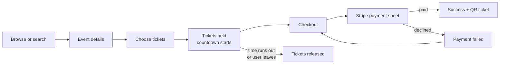
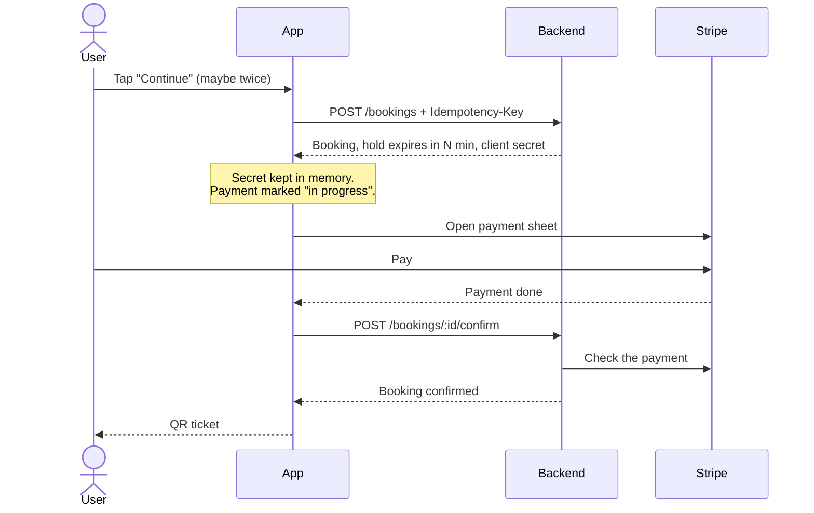
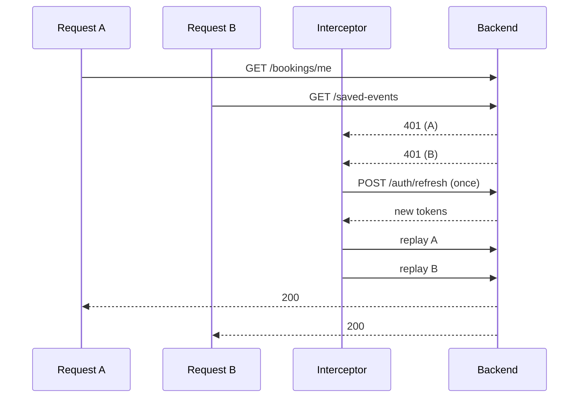
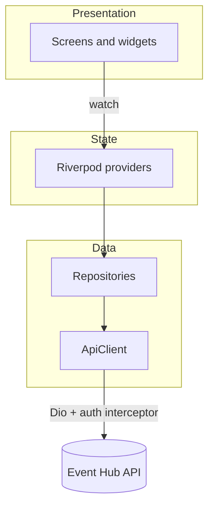

# Event Hub

A mobile app for discovering events and buying tickets, built with Flutter.
Find an event, pick your tickets, pay with a card, and walk in with a QR code.

This is the mobile client of a full-stack project. The backend is a separate
ASP.NET Core API:
[event-hub-DotNet](https://github.com/nguyen-duong-tien-phat/event-hub-DotNet).

<!--
Screenshots: add 3-4 images to docs/screenshots/ and show them here, e.g.
<p align="center">
  
  
  
  
</p>
-->

## What you can do in the app

- **Browse and search** events, filter by date, price and category, and scroll
  through long result lists that load page by page.
- **Save events** with a heart button that responds instantly.
- **Book tickets.** The tickets are held for you for a few minutes while you pay,
  with a live countdown.
- **Pay with Stripe** using the native payment sheet.
- **Show your ticket** as a QR code signed by the backend, so it can be checked
  at the door. Each ticket has its own code, with a short version to tap and copy
  when a QR will not scan, and a used ticket shows a USED label over a dimmed QR.
- **Sign up, log in and reset a forgotten password** with a code sent by email.
  The session renews itself, so you are not logged out in the middle of a purchase.

**Organizers and admins** get a different, read-only app when they sign in:

- **Follow sales.** Totals and a card per event (tickets sold, revenue, guests checked in), then each event's numbers by ticket type.
- **Preview an event** exactly as an attendee sees it, with the buy button switched off.
- **See who is coming.** The guest list with search and a checked-in filter, and the bookings on their events.
- **Check guests in at the door** by scanning the ticket's QR code with the camera, or by typing its short code. The answer is clear at a glance: admitted, already used (and when), not paid, not your event, or not a ticket.

Creating and editing events stays on the web dashboard.

## Tech stack


The app currently targets iOS. It is built with Flutter 3.47 and Dart 3.13.

| Area | Technology | What it is used for in this app |
| ---- | ---------- | ------------------------------- |
| App framework | Flutter, Dart | One codebase for every screen, written in Dart. |
| State management | Riverpod 3 (`flutter_riverpod`, `riverpod_annotation`) | Holds the signed-in user, event lists, saved events and bookings, and rebuilds screens when they change. |
| Navigation | GoRouter | Moves between screens and sends the user to the right place when they sign in or out. |
| Networking | Dio | Talks to the backend API, with an interceptor that adds the login token and renews it when it expires. |
| Payments | Stripe (`flutter_stripe`) | Opens the native Stripe payment sheet to pay for a booking. |
| Security | `flutter_secure_storage` | Keeps the sign-in tokens in the iOS Keychain. |
| Security | `uuid` | Creates the unique key sent with each booking so a retry never books twice. |
| UI and design | Custom Material theme, Geist and Instrument Serif fonts, Lucide icons | The app's own look: colors, text styles, fonts, icons and skeleton loading placeholders. |
| UI and design | `qr_flutter` | Draws the ticket QR code from the code signed by the backend. |
| UI and design | `intl` | Formats dates and prices for display. |
| Code generation and quality | `build_runner`, `riverpod_generator`, `flutter_lints` | Generates the Riverpod provider code, and checks the code against Flutter's lint rules. |
| Testing | `flutter_test` | Unit tests for the token refresh (with a fake HTTP adapter) and for page-by-page loading. |

### Backend (separate repo)

The API is [event-hub-DotNet](https://github.com/nguyen-duong-tien-phat/event-hub-DotNet):

- **ASP.NET Core (.NET 10)** Web API with **Entity Framework Core**
- **PostgreSQL 16** for data and **Redis 7** for caching and login rate limiting
- **Stripe** payments with webhook confirmation
- **JWT** sign-in with role-based access
- **Docker Compose** to run the API, database and Redis together
- **xUnit** and **Moq** unit tests, and **k6** load tests for the overselling check

## How a ticket gets bought



## What I focused on

These are the parts that were harder than a plain "fetch and show a list".

### 1. A booking that cannot be paid twice or lost

Mobile networks drop requests and people double tap. Each booking request carries
an `Idempotency-Key`, so a retry gives back the same booking instead of holding
the tickets twice. The Stripe client secret is only sent once, when the booking
is created, so the app keeps it until the payment is finished. While the payment
sheet is open, nothing is allowed to cancel the booking, so nobody pays for
tickets that were already given back.



### 2. Staying signed in without a refresh race

Access tokens expire. When several requests fail with a 401 at the same moment,
the app must not refresh the token several times, because each refresh token can
only be used once. A queued interceptor refreshes once, then replays every failed
request with the new token. Only a refused refresh signs the user out. Being
offline does not. This is covered by unit tests with a fake HTTP adapter.



### 3. Infinite scroll that handles failure

Discover, Search and the Tickets tab load 20 items at a time. Extra "load more"
calls while a page is loading are ignored, and a page that arrives after the list
was refreshed is dropped. If a page fails, the items already on screen stay and
a "Try again" row appears at the bottom, instead of the whole list turning into
an error.

### 4. Errors a user can read

Every network failure is turned into a small set of typed errors (validation,
conflict such as "tickets sold out", unauthorized, no connection, ...), each with
a plain message. Screens never deal with raw HTTP exceptions.

## How the app is organised



The code is split by feature (`auth`, `events`, `bookings`, `saved`, `profile`),
and each feature has its own `data` and `presentation` folders. Shared pieces
(networking, routing, theme, reusable widgets) live in `lib/core`.

```
lib/
  core/        networking, routing, theme, shared widgets
  features/
    auth/      login, sign up, forgot password
    events/    home, discover, search, event details
    bookings/  tickets, checkout, payment, QR ticket
    saved/     saved events
    profile/   profile tab
```

## Run it yourself

You need Flutter, Xcode, and the backend running (see its README).

```sh
flutter pub get
cp env/dev.example.json env/dev.json   # set API_BASE_URL and STRIPE_PUBLISHABLE_KEY
make run
```

On a real device, `API_BASE_URL` must be your computer's LAN IP, not `localhost`.

Other commands: `make test`, `make analyze`, `make gen-once` (regenerates the
Riverpod `*.g.dart` files, which are committed).
